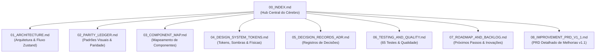

# 🧠 CÉREBRO DO PROJETO — FRAMECRAFT STUDIO

> **Status:** Produção Ativa | **Versão:** v1.1.0-framecraft  
> **Deploy Vercel:** [framecraft.app](https://framecraft.app)  
> **Repositório GitHub:** [github.com/Henrique1601/shots-studio](https://github.com/Henrique1601/shots-studio)  
> **Última Atualização:** 2026-10-30  

Este diretório `.brain/` funciona como o **Cérebro Persistente (*Second Brain*)** do projeto FrameCraft Studio, consolidando especificações, decisões arquiteturais (ADRs), padrões de estúdio visual, design tokens, cobertura de testes e roadmap.

---

## 🗂️ Mapa de Conhecimento do Cérebro



---

## 📑 Índice Detalhado dos Documentos

| Arquivo | Descrição |
| :--- | :--- |
| **[01_ARCHITECTURE.md](./01_ARCHITECTURE.md)** | Arquitetura técnica Next.js 16 (App Router), Zustand store unificado, motor de auto-containment e rendering 3D. |
| **[02_PARITY_LEDGER.md](./02_PARITY_LEDGER.md)** | Mapeamento comparativo e auditoria de excelência visual (12 estilos, telas, molduras, popovers). |
| **[03_COMPONENT_MAP.md](./03_COMPONENT_MAP.md)** | Catálogo de todos os componentes (`LeftSidebar`, `RightSidebar`, `MockupCanvas`, `DeviceModal`, `TopBar`, etc.). |
| **[04_DESIGN_SYSTEM_TOKENS.md](./04_DESIGN_SYSTEM_TOKENS.md)** | Cores de estúdio (`#0d0d0d`, `#161616`), 4 camadas de sombra adaptativa, física de molas (`framer-motion`). |
| **[05_DECISION_RECORDS_ADR.md](./05_DECISION_RECORDS_ADR.md)** | Histórico de decisões arquiteturais: por que Zustand sem Redux, por que SVG Masks com concentric bounds, etc. |
| **[06_TESTING_AND_QUALITY.md](./06_TESTING_AND_QUALITY.md)** | Suíte de testes automatizados (`tests/*.test.ts`), rotinas de build Turbopack e checklist de validação. |
| **[07_ROADMAP_AND_BACKLOG.md](./07_ROADMAP_AND_BACKLOG.md)** | Próximas iterações: renderização serverless Remotion de vídeo MP4, novos mockups e extensões. |
| **[08_IMPROVEMENT_PRD_V1_1.md](./08_IMPROVEMENT_PRD_V1_1.md)** | PRD de melhorias: cópia para o clipboard, filtros de imagem, suporte a vídeo nos mockups e dispositivos adicionais. |

---

## ⚡ Comandos Rápidos do Projeto

```bash
# Executar servidor de desenvolvimento com Turbopack
npm run dev

# Executar bateria de testes automatizados (65 testes)
npm test

# Compilação e build de produção
npm run build
```
