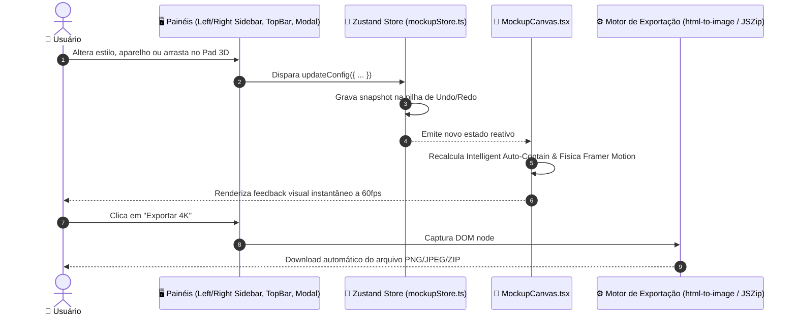

# 🏛️ 01_ARCHITECTURE.md — Arquitetura do Sistema

## 1. Visão Geral da Stack Tecnológica

O **FrameCraft Studio** foi projetado para oferecer a sensação de um aplicativo desktop de alto desempenho executado inteiramente no navegador:

- **Framework:** **Next.js 16.4.2** com **Turbopack** e React 19.
- **Gerenciamento de Estado:** **Zustand** com histórico nativo de `undo`/`redo` (armazenamento de até 50 snapshots).
- **Estilização:** Tailwind CSS com variáveis de design tokens FrameCraft Studio e `clsx` / `tailwind-merge`.
- **Animações & Física 3D:** **Framer Motion** com transformações espaciais via CSS 3D (`perspective: 150em`, `rotateX`, `rotateY`, `rotateZ`, `scale`).
- **Motor de Exportação:** `html-to-image` com escalonamento de densidade de pixels em 1x (FHD), 2x (4K) e 3x (6K), com renderização paralela de carrossel em lote via `JSZip`.
- **Persistência Local-First:** `Dexie.js` (IndexedDB) para salvamento offline de rascunhos e projetos.

---

## 2. Diagrama de Fluxo de Dados (Data Flow)

---

## 3. Motor de Contenção Inteligente (Intelligent Auto-Contain)

Um dos maiores desafios de UX em ferramentas de mockup é garantir que **nenhuma imagem ultrapasse as bordas da tela principal**, independentemente da proporção original da mídia:

$$R_{\text{frame}} = \frac{W_{\text{frame}}}{H_{\text{frame}}}$$
$$R_{\text{mockup}} = \begin{cases} 
R_{\text{device}} & \text{se physical device} \\
\frac{W_{\text{media}}}{H_{\text{media}}} & \text{se screenshot/browser com mídia} \\
1.333 & \text{fallback padrão (4:3)}
\end{cases}$$

Se $R_{\text{mockup}} < R_{\text{frame}}$ (o mockup é mais vertical/alto que a moldura):
- A altura é fixada proporcionalmente (`height: 74%`).
- A largura se ajusta automaticamente (`width: auto`).
- Máximos estritos impedem overflow: `max-width: 92%`, `max-height: 90%`.

Se $R_{\text{mockup}} \ge R_{\text{frame}}$ (o mockup é mais horizontal/largo que a moldura):
- A largura é fixada proporcionalmente (`width: 74%`).
- A altura se ajusta automaticamente (`height: auto`).

---

## 4. Arquitetura Multi-Slide (Carrossel em Lote)

O estúdio suporta a criação de múltiplos slides independentes em uma mesma sessão:
1. Cada slide armazena seu próprio conjunto de imagens (primária, secundária, terciária) e configurações exclusivas de moldura.
2. O **CarouselBar** inferior permite duplicar, reordenar, adicionar e alternar slides com transições suaves.
3. O botão de exportação em lote gera um arquivo `.zip` com numeração ordenada sequencial (`slide-01.png`, `slide-02.png`, etc.).

## 🔄 Refatoração Arquitetural v1.2 (Desmembramento de Monólitos)

- **LeftSidebar.tsx reduzido de 2.549 para 85 linhas**: Atua agora estritamente como orquestrador dos sub-painéis.
- **MockupTab.tsx (762 linhas)**: Isolado em src/components/sidebar/MockupTab.tsx.
- **FrameTab.tsx (1.109 linhas)**: Isolado em src/components/sidebar/FrameTab.tsx.
- **MiniSidebars.tsx (718 linhas)**: Isolado em src/components/sidebar/MiniSidebars.tsx.
- **useCanvasOrbit.ts (86 linhas)**: Hook desacoplado de órbita 3D, precisão com Shift e reset duplo-clique.
- **CanvasOverlays.tsx (216 linhas)**: Extraído de MockupCanvas (VFX, iluminação de estúdio, anotações, marca d'água, 3D shapes).
- **src/constants/presets.ts & shapes.ts**: Separação clara entre tipos puros (	ypes/mockup.ts) e constantes/presets de renderização.
