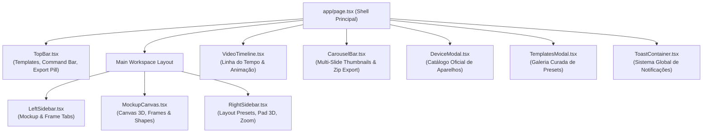

# 🗺️ 03_COMPONENT_MAP.md — Mapeamento de Componentes

Catálogo detalhado de todos os componentes de interface e blocos funcionais do projeto.

---

## 🏗️ Hierarquia de Componentes

---

## 📦 Especificação de Cada Componente

### 1. `TopBar.tsx`
- **Responsabilidade:** Barra superior do aplicativo.
- **Seção Esquerda:** Avatar do usuário, chevron de navegação e pílula `Templates >` para abrir a galeria.
- **Seção Central (Command Bar com 7 Ações):**
  - Desfazer (`Undo` - atalho `Ctrl+Z`)
  - Refazer (`Redo` - atalho `Ctrl+Y`)
  - Embaralhar cores e estilos aleatórios (`Shuffle`)
  - Restaurar padrão (`Start Over`)
  - Tela cheia (`Fullscreen`)
  - Modal de suporte e feedback (`Feedback`)
  - Alternador de modo de performance (`Performance`)
- **Seção Direita:** Pílula unificada de exportação (`↑ Export 1x · JPEG`), botão de cópia direta para a área de transferência e popover de configurações de formato/resolução.

### 2. `LeftSidebar.tsx`
- **Largura:** 228px fixa.
- **Abas:** Deslizamento horizontal suave contínuo entre `Mockup` e `Frame`.
- **Aba Mockup:**
  - Seletor do aparelho ativo com thumbnail.
  - `Magic Preset` (navegação rápida com setas `‹` e `›`).
  - Dropzone de mídia (`Drop media or click to choose`).
  - Grid de **12 Estilos** em 3 colunas (`grid-cols-3`).
  - Seletor de borda: `Sharp` (0px), `Curved` (20px), `Round` (36px) e slider manual (0 a 40px).
  - Seletor de sombra: 4 presets visuais, barra de opacidade (10 a 70%) e gaveta de ajuste de luz `Adjust Light`.
  - Controle de visibilidade: `Hide Mockup` / `Show Mockup`.
  - Bloco **DETAILS**: Exibição em tempo real do aparelho e resolução de tela.
- **Aba Frame:**
  - Proporções padrão (16:9, 1:1, 4:5, 9:16, etc.) e redes sociais (Post, Story, Cover, etc.).
  - Inputs manuais de largura $W$ e altura $H$ com botão de aplicação `Set`.
  - Coleções de fundos: Sólidos, Gradientes Cósmicos, Místicos 4K, Desktop Tahoe, Vidro e Unsplash.
  - Efeitos de estúdio: Vinheta, Ruído analógico (SVG Noise), Watermark Shots.so e Iluminação Portrait Apple.

### 3. `MockupCanvas.tsx`
- **Responsabilidade:** Renderizador central de alta fidelidade visual.
- **Física 3D:** Órbita interativa direta por clique e arraste no canvas, rotação contínua e desaceleração por molas Framer Motion (`stiffness: 320, damping: 28`).
- **Renderizador Físico de Aparelhos:** Máscaras vetoriais concêntricas (`maskSvg`) que eliminam vazamento de cores do gradiente de fundo, chassis realistas em titânio e botões de hardware.
- **Modos de Aparelho:** Único (Single), Duplo (Duo) e Triplo (Trio) com ajuste dinâmico de espaçamento (`duoGap`).

### 4. `RightSidebar.tsx`
- **Largura:** 228px fixa.
- **Seletor de Modo:** 1 aparelho, 2 aparelhos, 3 aparelhos.
- **Abas de Ajuste:** `Zoom` vs `Tilt`.
- **Pad Espacial 3D:** Painel tátil bidimensional com captura de ponteiro para rotação nos eixos X e Y, botão indicador central e suporte à tecla `Shift` para micro-ajustes de precisão.
- **Layout Presets:**
  - Card dinâmico `Custom Layout` com botão de reset `✕`.
  - Presets oficiais: `Flat Center (100%)`, `Isometric Left (110%)`, `Isometric Right (110%)`, `Perspective Tilt (105%)`, `Rear Elevation (100%)`, `Bottom Focus (125%)`, `Side Angle (110%)`.

### 5. `DeviceModal.tsx`
- **Responsabilidade:** Catálogo modal estruturado por seções oficiais (`Essentials`, `iPhone 17 Lineup`, `Flagships & Workstations`) e filtros no topo por tipo de dispositivo com seleção instantânea.
