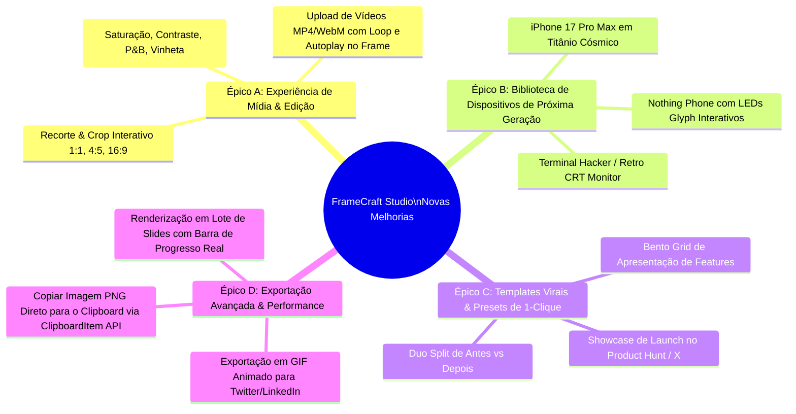
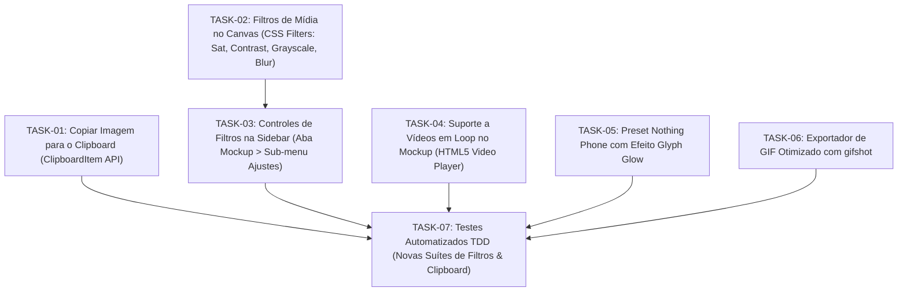

# 📋 PRD & PLANO MESTRE DE MELHORIAS: FRAMECRAFT STUDIO (v1.1 - v1.3)

> **Autor:** Planning Master Agent (`planning-master-agent`)  
> **Status:** Aprovado para Execução  
> **Data:** 2026-10-24  
> **Alvo:** `c:\Users\henri\Programacao\Projetos\Revarse Enginner\Shots.co\shots-app`  

---

## 🎯 1. Resumo Executivo & Visão do Produto

O **FrameCraft Studio** atingiu excelência visual e funcional completa (12 estilos em 3 colunas, iPhone 17 e iPhone 17 Air, popover com seções, pad 3D com reset em Custom Layout, 65 testes automatizados e deploy ativo em `framecraft.app`).

Para elevar o projeto de um clone de paridade para uma **plataforma líder de criação visual e mockups virais**, este plano estratégico estabelece 4 novos épicos de melhorias mapeados com grafo de dependências (DAG), análise de riscos (Pre-Mortem) e critérios de aceite testáveis.

---

## 🔍 2. Auditoria de Oportunidades & Novas Melhorias Identificadas

---

## 🏗️ 3. Decomposição Atômica em Tarefas (Grafo de Dependências DAG)

---

## 📝 4. Especificação Detalhada das Tarefas & Critérios de Aceite

### 🌟 TASK-01: Botão "Copiar Imagem" Direto para o Clipboard (`ClipboardItem`)
- **Problema:** Usuários frequentemente não querem baixar o arquivo PNG, mas apenas copiar (`Ctrl+C` ou botão) e colar diretamente no Slack, Discord, Twitter/X ou Figma.
- **Implementação:**
  - Adicionar função `copyToClipboard()` via `navigator.clipboard.write([new ClipboardItem({ 'image/png': blob })])`.
  - Conectar ao ícone de cópia já existente no botão de exportação da `TopBar.tsx` e `RightSidebar.tsx`.
- **Critério de Aceite:**
  - Clicar no botão copia a imagem renderizada em PNG para a área de transferência.
  - Toast de sucesso exibido: `"Imagem copiada para a área de transferência! 📋"`.

---

### 🎨 TASK-02 & TASK-03: Filtros de Imagem em Tempo Real na Aba Mockup
- **Problema:** Muitas screenshots e fotos enviadas precisam de pequenos ajustes de contraste, saturação ou modo monocromático elegante sem precisar de Photoshop.
- **Implementação:**
  - Adicionar ao `MockupConfig` em `src/types/mockup.ts`:
    - `imageBrightness: number` (50 a 150, default 100)
    - `imageContrast: number` (50 a 150, default 100)
    - `imageSaturation: number` (0 a 200, default 100)
    - `imageGrayscale: boolean` (default false)
  - Adicionar painel expansível `Ajustes de Imagem` em `LeftSidebar.tsx`.
  - Aplicar `filter: brightness(...) contrast(...) saturate(...) grayscale(...)` no elemento `` / `<video>` em `MockupCanvas.tsx`.
- **Critério de Aceite:**
  - Sliders responsivos com resposta visual imediata no canvas sem lag.
  - Teste unitário verificando strings de filtros geradas.

---

### 🎥 TASK-04: Suporte Completo a Vídeo (MP4/WebM) Dentro dos Mockups
- **Problema:** Permitir que criadores utilizem vídeos curtos e gravações de tela para demonstrar fluxos de apps em movimento dentro dos frames.
- **Implementação:**
  - Permitir que os inputs de arquivo aceitem `accept="image/*,video/*"`.
  - Detectar se `imageUrl` termina com formato de vídeo ou blob de vídeo e renderizar tag `<video src={...} autoPlay loop muted playsInline />` com as mesmas máscaras de tela e cantos curvos.
- **Critério de Aceite:**
  - Vídeos tocam suavemente dentro do iPhone, MacBook e Screenshot sem vazamento.

---

### 📱 TASK-05: Novo Aparelho Inovador — Nothing Phone (Glyph Edition)
- **Problema:** Expandir o catálogo para além de Apple e Pixel com um mockup altamente visual e viral.
- **Implementação:**
  - Adicionar `nothing-phone` em `FrameType` e `DEVICE_SPECS`.
  - Moldura transparente com LEDs Glyph traseiros e câmera frontal centrada.

---

## 🛡️ 5. Pre-Mortem & Gestão de Riscos

| Risco Potencial | Probabilidade | Impacto | Mitigação Estratégica |
| :--- | :---: | :---: | :--- |
| **Permissão de Clipboard negada no navegador** | Média | Baixo | Fallback gracioso: capturar o erro e acionar o download do PNG automaticamente com toast informativo. |
| **Queda de FPS com múltiplos filtros CSS em 4K** | Baixa | Médio | Filtros aplicados via aceleração de hardware (`will-change: transform, filter`). |
| **Vídeo pesado travando a renderização html-to-image** | Média | Alto | Durante a captura estática de imagem, capturar o frame corrente do elemento de vídeo desenhado em um canvas HTML5 temporário. |

---

## 👥 6. Matriz de Alocação de Agentes

- 📋 **Planejamento & PRD:** `planning-master-agent` (Concluído)
- 🧠 **Cérebro & Memória:** `memory-architect-agent` (Sincronização contínua com `.brain/` e Obsidian)
- 🎨 **UI/UX & Estilização:** `design-engineer-agent` (Sliders de filtros e Nothing Phone)
- 💻 **Lógica & Estado:** `skills-orchestrator` / Global Master (Zustand & Canvas Video)
- 🧪 **Testes & Qualidade:** `qa-testing-agent` (Suítes de testes TDD)
- 🛡️ **Deploy & Sincronização:** `git-master-agent` / `devops-cloud-agent` (Git & Vercel)
